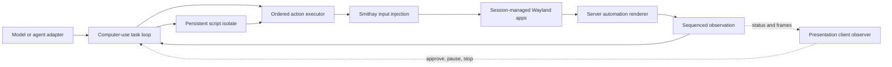

# Computer Use

## Objective

Brood computer use lets an agent observe and control applications hosted inside
Brood sessions. The complete observe, decide, act, and verify loop runs beside
the session compositor in `brood-sessiond`; it does not depend on a connected
presentation client.

The public interaction model deliberately follows OpenAI Codex computer use.
It provides both direct computer actions and persistent code execution so a
model can perform a short action interactively or express a long sequence as a
compact script.

Host-desktop control is out of scope. Client-local plugin panes are also absent
from the initial visual computer because they do not exist in the server's
Wayland scene. Plugins may later expose structured tools without changing this
boundary.

## Product invariants

- Computer use can observe and control only managed applications authorized for
  its Brood session.
- Capture, input injection, action ordering, settling, and script execution are
  server-side operations.
- The facility remains usable with zero presentation clients connected.
- A presentation client may observe progress, request approval, pause, or stop
  a run, but it is not in the control loop.
- Direct actions use the Codex-compatible vocabulary: `click`, `double_click`,
  `scroll`, `type`, `wait`, `keypress`, `drag`, `move`, and `screenshot`.
- Scripts use a persistent task-scoped runtime and call the same underlying
  capture and input operations as direct actions.
- Generated code has no ambient filesystem, network, process, DBus, or host
  desktop authority.
- Every externally visible action has a task identity, sequence number, target
  session, lease generation, timestamps, and result.

## Architecture

`brood-sessiond` owns the task loop, the lease, and the automation renderer.
Adapters translate an external agent protocol into Brood's internal task and
action types. No adapter is authoritative for action semantics.

### Relationship to presentation

The automation viewport is not a human presentation surface. It is a fixed,
server-owned projection used only for machine observation, coordinate mapping,
and deterministic input. The presentation client continues to own human
layout, final composition, and platform-native interaction.

The existing presentation design says the server never creates a native or
offscreen presentation target. Implementing computer use requires narrowing
that invariant: the server still does not create a *human presentation target*,
but it does create an isolated automation render target. The presentation
protocol must not acquire automation-layout authority as a side effect.

## Automation viewport

The first viewport profile is a fixed 1440 by 900 logical-pixel canvas. It
contains only server-managed Wayland applications from the authorized session.
The server owns its active window, z order, clipping, coordinate transform, and
focus independently from every connected client.

The initial layout should favor determinism over desktop fidelity:

1. One active managed window fills the usable viewport while preserving its
   configured content size where practical.
2. Switching the active window changes the automation projection, not the
   human client's layout.
3. Window metadata remains available so future tools can select a target by
   stable managed-pane or application identity.

An observation contains the original PNG bytes plus viewport size, task and
sequence identity, active-window identity, visible-window inventory, and settle
state. Capture must work for both DMA-BUF and SHM-backed application buffers.
Screenshots are generated from server-owned scene state; debug-dump paths are
not the production API.

## Direct action execution

An action request contains one or more actions. The server validates the entire
batch against the current lease and then executes valid actions in order on the
session event loop. It returns per-action results followed by a causally newer
observation.

Input reuses the compositor's existing keyboard, pointer, button, axis, and
focus paths. The executor adds automation-specific state for held modifiers,
button cleanup, drag interpolation, coordinate validation, cancellation, and
provenance. Cancellation must release every key and button held by the task.

`wait` is not an arbitrary server sleep. It yields the event loop until the
requested interval and then participates in the same settle-and-observe path.
Settling initially combines a short quiet period with bounded timeouts and
frame/input sequence markers. Later application-specific readiness signals may
improve it without changing the tool contract.

## Code execution

The code tool is named `exec_js`. Each computer-use task receives one
persistent JavaScript global environment so variables and helper functions
survive between calls. A call returns console output, displayed images, a
structured value, execution metrics, and any exception.

The preferred implementation is QuickJS hosted inside a dedicated WASM
isolate. The isolate receives explicit, narrow host capabilities rather than
direct access to Brood internals. Its initial globals are:

- `computer.screenshot()` and `display(image)`;
- direct action helpers matching the action vocabulary;
- `computer.perform(actions)` for ordered batches;
- `computer.windows()` and `computer.activeWindow()`;
- `computer.accessibilitySnapshot()` when an accessibility provider exists;
- `page` when the active application has an authorized Chromium DevTools
  binding;
- `askUser(prompt)` for an approval or information checkpoint;
- `console` and task-scoped `globalThis`.

Every asynchronous helper marshals a typed command to the session event loop.
The JavaScript engine never holds compositor objects or bypasses lease and
policy checks. CPU time, wall time, memory, output, image count, and queued host
calls are bounded. Terminating a task destroys its isolate and cancels its
outstanding calls.

## Semantic adapters

Pixels and input are the universal fallback. Two optional server-side semantic
providers make scripts faster without changing what the session controls:

- AT-SPI exposes native application accessibility trees and actions.
- Chromium DevTools exposes DOM and browser automation for managed Chromium
  applications.

Both providers resolve nodes back to the task's authorized session and active
window. A semantic handle is revisioned and becomes invalid when its backing
window, document, or accessibility tree changes.

## Lease and human interaction

The first implementation uses one daemon-wide computer-use lease because the
current compositor seat and focus state are shared. The lease names the task's
authorized session and window set even though exclusivity is daemon-wide.

A connected presentation client can observe without holding the automation
lease. Human primary input pauses the task or revokes the lease according to
policy; it must never silently interleave with agent input. Approval-required
actions block at the server and publish a request to all eligible observers.
The server applies the decision even if the requesting client disconnects.

## Internal protocol

The implementation should define transport-neutral domain types before adding
external adapters:

- `ComputerUseTask`: identity, principal, scope, policy, state, and limits;
- `ComputerUseLease`: generation, authorized session/windows, and expiry;
- `ComputerActionBatch`: task, expected sequence, actions, and approval proof;
- `ComputerActionResult`: ordered status, timing, and failure classification;
- `ComputerObservation`: PNG, metadata, sequence, and settle evidence;
- `ComputerScriptRequest` and `ComputerScriptResult`;
- `ComputerApprovalRequest` and `ComputerApprovalDecision`.

The initial external adapter should model the OpenAI computer-call loop closely
enough that a trained model can use its familiar action and screenshot shapes.
An MCP surface can expose the same direct-action and `exec_js` tools. DBus may
support local diagnostics and observer UX, but should not become the remote
streaming protocol.

## Implementation plan

### Phase 0: Freeze the contract

Define the domain types, state machine, action schemas, error taxonomy, limits,
and golden protocol fixtures. Amend the presentation-client invariant to
distinguish automation rendering from human presentation. Add a minimal fake
adapter that can drive contract tests without a model provider.

Exit criterion: action batches, observations, approvals, cancellation, and
script calls have versioned fixtures and explicit lifecycle transitions.

### Phase 1: Build server capture and automation layout

Extract reusable buffer import and readback from frame export and debug capture.
Add the 1440 by 900 automation scene, window selection, deterministic layout,
PNG encoding, metadata, and monotonically sequenced observations.

Exit criterion: a nested real application renders changing DMA-BUF and SHM
content, and server captures prove correct pixels and active-window identity
with no presentation client.

### Phase 2: Execute direct actions

Add the exclusive lease, ordered executor, coordinate validation, full direct
action vocabulary, input cleanup, settle detection, cancellation, and audit
events. Reuse the normal Smithay paths rather than adding an application-side
input channel.

Exit criterion: a nested workload is clicked, typed into, scrolled, dragged,
and shortcut-controlled; screenshots and application-visible results prove each
action, including cancellation and stale-lease rejection.

### Phase 3: Close the server-side control loop

Implement task orchestration, policy gates, observation streaming, approval
requests, pause/resume/stop, and a Codex-shaped direct-computer adapter. Add an
observer surface for clients without making client availability a dependency.

Exit criterion: an adapter completes a multi-step GUI task while the human
client is disconnected, then a replacement client reconnects and observes the
same task state.

### Phase 4: Add persistent `exec_js`

Package the JS-in-WASM runtime, expose bounded host calls, preserve globals
between invocations, implement display and console output, enforce resource
limits, and destroy isolates reliably on task termination.

Exit criterion: one script performs a long action sequence faster than
round-tripping every action, displays verification screenshots, retains state
across calls, and cannot access filesystem, network, processes, DBus, or host
desktop resources.

### Phase 5: Add semantic scripting

Integrate AT-SPI and authorized Chromium DevTools providers behind revisioned
handles. Expose them through `computer` and `page` helpers while keeping pixel
actions available as the fallback.

Exit criterion: native and browser workloads can be queried and manipulated
semantically, with tests proving cross-session and stale-handle denial.

### Phase 6: Product UX and hardening

Add approval and takeover UX, explicit automation indicators, audit history,
redaction controls, telemetry, disconnect recovery, backpressure, protocol
negotiation, and remote authentication. Revisit lease granularity only after
the compositor has independent seats and focus domains.

Exit criterion: threat-model review and sustained nested workloads cover prompt
injection checkpoints, observer churn, slow consumers, crashes, task recovery,
and resource exhaustion.

## Verification strategy

Behavior verification uses Brood's Nix-backed nested test path and real GUI
applications. Each phase records daemon metrics, action and frame sequences,
application-visible state, and screenshots. Unit tests are appropriate for
schemas, transforms, state machines, and sandbox limits, but they do not replace
a nested end-to-end proof.

The implementation tracker is [[../workflows/computer-use-tracker]].
