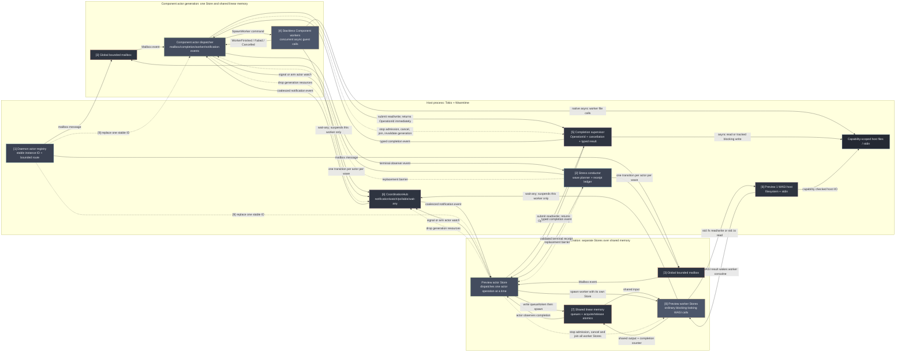

# Plugin I/O Interaction Graph

Solid arrows carry messages, commands, results, or I/O. Dashed arrows are
generation lifecycle operations. The daemon registry is the production entry
point. The Rube Goldberg conductor is a test-only entry point which drives the
same runtimes and adds an exactly-once receipt ledger.

The standalone [SVG rendering](plugin-io-interaction-graph.svg) is useful when
the documentation renderer does not support Mermaid:





## Operation Key

| ID | Operation | Who may suspend? | Return path | Source |
| --- | --- | --- | --- | --- |
| 1 | Production routing by stable actor instance ID | Neither actor nor caller blocks on mailbox capacity; admission succeeds or rejects immediately | Message enters exactly one hosted actor's bounded global mailbox | [`state.rs`](../../crates/manifoldd/src/state.rs#L438), [`state.rs`](../../crates/manifoldd/src/state.rs#L852) |
| 2 | Deterministic stress wave | The conductor waits after admitting up to one transition per actor; actors run concurrently | Component terminal events and Preview shared-memory counters are matched by the bounded receipt ledger | [`io_rube_goldberg.rs`](../../crates/manifold-wasm/examples/io_rube_goldberg.rs#L520), [`io_rube_goldberg.rs`](../../crates/manifold-wasm/examples/io_rube_goldberg.rs#L625) |
| 3 | Actor mailbox dispatch | The actor may be idle waiting for its next event; it does not block on worker I/O | Guest dispatcher returns commands, then the host services another event lane | [`component_actor.rs`](../../crates/manifold-wasm/src/component_actor.rs#L1360), [`preview1_worker.rs`](../../crates/manifold-wasm/src/preview1_worker.rs#L1600) |
| 4 | Component worker execution and native worker file I/O | Only that stackless worker future suspends | A worker terminal event re-enters the actor system lane and is also observable by the host | [`component_actor.rs`](../../crates/manifold-wasm/src/component_actor.rs#L596), [`component_actor.rs`](../../crates/manifold-wasm/src/component_actor.rs#L1417), [`component_actor.rs`](../../crates/manifold-wasm/src/component_actor.rs#L1511), [`wasm-component-actor`](../../examples/wasm-component-actor/src/lib.rs#L136) |
| 5 | Actor completion read/write/cancel in either backend | The actor never waits for the filesystem operation | A generation-scoped `ActorCompletion` is queued back to the actor completion lane | [`completion_io.rs`](../../crates/manifold-wasm/src/completion_io.rs#L182), [`completion_io.rs`](../../crates/manifold-wasm/src/completion_io.rs#L378), [`component_actor.rs`](../../crates/manifold-wasm/src/component_actor.rs#L1443), [`preview1_worker.rs`](../../crates/manifold-wasm/src/preview1_worker.rs#L1650), [`wasm-preview1-worker`](../../examples/wasm-preview1-worker/src/lib.rs#L242) |
| 6 | Notification signal, actor watch, and worker `wait-any` | Actor watch is nonblocking; worker `wait-any` suspends only the calling worker | Coalesced actor notification event or selected pollable index | [`coordination.rs`](../../crates/manifold-wasm/src/coordination.rs#L283), [`coordination.rs`](../../crates/manifold-wasm/src/coordination.rs#L330), [`coordination.rs`](../../crates/manifold-wasm/src/coordination.rs#L517) |
| 7 | Guest-owned shared-memory communication | No host-managed channel wait is required; workers may combine atomics with notification waits | Acquire/release atomics publish queue data and terminal counters to the actor | [`wasm-preview1-worker`](../../examples/wasm-preview1-worker/src/lib.rs#L265), [`wasm-preview1-worker`](../../examples/wasm-preview1-worker/src/lib.rs#L292) |
| 8 | Ordinary Preview 1 WASI from a worker | Only the worker Store/coroutine waits; sibling workers and the actor continue | Standard WASI return value resumes the worker, which publishes or returns its result | [`preview1_worker.rs`](../../crates/manifold-wasm/src/preview1_worker.rs#L2177), [`wasm-preview1-worker`](../../examples/wasm-preview1-worker/src/lib.rs#L588), [`wasm-preview1-worker`](../../examples/wasm-preview1-worker/src/lib.rs#L599) |
| 9 | Replacement and structured shutdown | The old generation is quiesced and joined; unrelated actors remain live | A new generation is published under the same ID; old operation IDs and coordination handles are rejected | [`state.rs`](../../crates/manifoldd/src/state.rs#L4078), [`state.rs`](../../crates/manifoldd/src/state.rs#L4191), [`io_rube_goldberg.rs`](../../crates/manifold-wasm/examples/io_rube_goldberg.rs#L1598) |

## One Transition, End To End

```text
host plans (transition, generation, input, expected checksum)
  -> bounded actor mailbox admission
  -> actor dispatches the mailbox event
  -> guest actor spawns a worker
  -> worker computes or performs I/O while the actor remains dispatchable
  -> Component: WorkerFinished event
     Preview 1: release-store output and increment completion counter
  -> host checks backend + actor slot + generation + output exactly once
  -> next deterministic chain value
```

The target contract and lifecycle rules are specified in
[[plugin-io-and-resources]].
