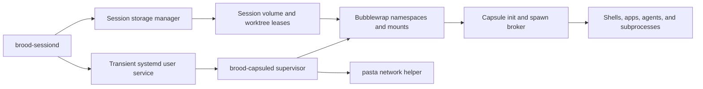

# Session Isolation

## Objective

A local Brood session is an easy-to-enter, lightweight Linux capsule. Processes
in different sessions can use the same port numbers, DBus names, temporary
paths, and familiar absolute filesystem paths without accidentally sharing
runtime state or writing through to the same host paths.

Isolation is the default for new local sessions. The existing host-native
execution model remains available as an explicit `direct` profile. If the host
cannot construct an isolated session, Brood never silently degrades to direct
execution.

This boundary protects trusted local peers from accidental cross-session and
host contamination. It is not advertised as containment for hostile code.

## Product Invariants

- A running **capsule** is the Linux process and namespace boundary for one
  isolated session.
- A persistent **session volume** contains that session's copy-on-write data
  and survives capsule teardown.
- The session storage manager owns volume and managed-worktree policy. Native
  host code owns cgroup, namespace, mount, reflink, export, and deletion
  mechanisms.
- Every process launched on behalf of a session enters that session's capsule.
  Descendants remain in the same session cgroup and namespaces naturally.
- Plugins continue to run in their established host runtimes, but every
  session-scoped subprocess, PTY, or socket operation they request crosses the
  capsule broker.
- Storage-manager-owned or adopted exclusive Git worktrees are ordinary
  directly writable session resources. Primary, unmanaged, or shared
  checkouts use the session volume's copy-on-write view.
- Namespace or mount failure is visible. An interactive caller may explicitly
  accept a direct session; noninteractive and plugin callers fail closed.
- Resource accounting is always available. CPU, memory, I/O, and process limits
  are opt-in policy, not surprise defaults.

## Architecture



Brood uses the best-fitting Linux mechanism at each layer rather than adopting
an OCI image or container-daemon workflow:

- systemd owns the cgroup, accounting, delegated controllers, and whole-session
  termination;
- Bubblewrap constructs the rootless user, mount, PID, IPC, UTS, network, and
  cgroup namespaces and the filesystem view;
- pasta gives the private network namespace outbound connectivity without a
  privileged bridge;
- `brood-capsuled` owns namespace readiness, process brokering, PID-1 reaping,
  terminal handling, and helper supervision;
- the storage manager owns durable data and retention policy.

### Capsule service

Each volume has a transient user service named from its stable volume ID under
a Brood sessions slice. The service contains the outer supervisor, Bubblewrap,
capsule init, pasta, and every session descendant. It enables CPU, memory, I/O,
and task accounting and delegates the supported cgroup-v2 controllers so
rootless Podman, Distrobox, and similar tools can create a nested hierarchy.
Brood applies no additional hard limit unless the selected configuration does
so explicitly.

The outer `brood-capsuled` mode remains in the host namespaces. It starts
Bubblewrap, waits for the inner broker to become ready, attaches pasta to the
new network namespace, and reports structured readiness or failure. The inner
mode is PID 1 in the capsule. It reaps children, forwards termination, and
serves the spawn protocol.

Closing a session first requests bounded graceful termination. Expiry stops the
complete service cgroup, so double forks and orphaned descendants cannot escape
cleanup.

### Spawn broker

The broker uses a versioned Unix `SOCK_SEQPACKET` protocol with bounded Postcard
messages. File descriptors cross with `SCM_RIGHTS`; process identity uses
pidfds rather than reusable numeric PIDs. The protocol supports:

- argv, cwd, and an explicit environment delta;
- direct stdio, bounded pipe streams, detached launches, and PTYs;
- terminal resize, signal, wait, exit status, and exit-by-signal reporting;
- pane and session launch metadata;
- TCP connect, listen, and accept inside the capsule network namespace.

The broker socket is reachable from `brood-sessiond` through a private runtime
path. It is not exposed through the host filesystem view presented to sibling
sessions.

All session-scoped native launch paths use one process-backend abstraction:

- entered shells and requested commands;
- hosted Wayland applications;
- applications launched by the session-init actor;
- component and Preview1 plugin subprocess and PTY resources;
- managed Chromium and its DevTools connection;
- computer-use application launch.

Daemon-global storage, transport, presentation, and backend-management helpers
remain host processes. Direct native spawn sites must be classified explicitly
as daemon-global or converted to the capsule backend.

`brood enter` receives an execution channel from the daemon. It proxies an
interactive PTY and window-size changes when attached to a terminal, passes
ordinary descriptors for noninteractive execution, and returns the command's
exact exit or signal-derived status.

Session-runner activation happens inside the capsule. The activation wrapper
remains the outer lifecycle owner, but its launch record is passed explicitly
rather than inferred from a per-command cgroup name: the capsule cgroup names
the session, not one invocation.

## Namespace And Bridge Policy

The standard capsule creates private user, mount, PID, IPC, UTS, network, and
cgroup namespaces. It leaves further user-namespace creation available for
rootless nested containers.

Each session has its own loopback interface. Pasta supplies normal outbound
IPv4 and IPv6 connectivity. Automatic inbound forwarding, automatic host-port
publication, and ambient host-loopback mapping are disabled. Brood services
that need to reach a session-local listener, such as Chromium DevTools, ask the
broker to open the connection inside the namespace.

The initial host bridge set preserves current Brood application behavior:

- the Brood nested Wayland socket;
- the Brood control endpoint;
- the session-local DBus bus and its notification bridge;
- GPU devices required by managed graphical applications;
- clipboard exchange through the compositor;
- outbound network access through pasta.

PipeWire, portals, document access, SSH or GPG agents, arbitrary host sockets,
and published inbound ports require later named bridges. The host runtime and
socket directories are never mounted wholesale merely to make one integration
work.

## Filesystem View

The capsule sees familiar host path names. A read-only base supplies files that
have not changed in the session, while OverlayFS domains redirect ordinary
writes into the session volume.

The mount planner must reject an upper or work directory nested beneath its
lower directory. It assembles several explicit domains instead of attempting
one fragile overlay across `/`.

The standard plan provides:

- copy-on-write views for unmanaged working checkouts and the Git
  administrative paths required to use them;
- copy-on-write `/etc`, selected regular `/var` paths, and writable home and XDG
  domains;
- private `/tmp`, `/var/tmp`, and `XDG_RUNTIME_DIR`;
- a read-only Nix store and read-only base system paths;
- a private `/proc` reflecting the PID namespace;
- a minimal `/dev` plus explicitly bridged GPU devices;
- hidden Brood storage and host runtime roots.

Special kernel filesystems, device nodes, credentials, and manager-owned data
are read-only, hidden, or bridged explicitly rather than treated as ordinary
copy-on-write files.

An exclusive linked Git worktree may be mounted directly only while the
storage manager holds its lease. The lease covers the worktree and the Git
administrative paths needed for index, branch, and object updates. A primary
checkout or a path shared by multiple sessions is not made direct merely
because it happens to have one current Brood user.

## Reflink-Primed Worktrees

Managed worktree creation treats the requesting session's actual worktree and
HEAD as its source context. A new branch starts from that HEAD. Attaching an
existing branch keeps that branch's own HEAD.

Before new provisioning, the manager still recognizes and reuses a valid
existing managed checkout and repairs interrupted acquisition records.

When a new target is required, the manager probes whether the source and target
filesystems support reflink cloning. The optimized path is:

1. Register a provisional target with `git worktree add --no-checkout`.
2. Enumerate paths tracked by the target commit.
3. Reflink matching regular files from the source worktree and preserve
   matching symlinks without following them.
4. Populate and refresh the target index with a mixed reset.
5. Checkout only tracked paths that are missing or differ from the target
   commit.
6. Verify that the resulting tracked worktree is clean before publishing its
   metadata.

The seed list comes from the target tree. It never copies `.git`, source-only
tracked paths, submodule contents, or non-ignored untracked files. Normalizing
against the target commit removes modifications to tracked source files while
leaving identical files reflink-shared.

When the target HEAD equals the source session HEAD, the manager also primes
ignored data so a new worktree does not need conventional setup scripts merely
to reconstruct existing dependencies and build state. Ignore classification
uses the target's committed ignore rules, not a modified `.gitignore` in the
source worktree. The manager reflinks ignored regular files and complete
ignored directories and preserves ignored symlinks without following them.
Examples include `node_modules`, Rust `target` trees, virtual environments, and
downloaded tool caches.

Ignored data is not inherited when an existing branch points at a different
commit. Sockets, FIFOs, device nodes, and other special ignored entries are
never copied.

Reflink priming is transactional. The manager records every provisional path
and Git registration. If the capability probe or any required clone fails, it
removes the provisional worktree through Git, cleans only the validated managed
target, and runs the ordinary `git worktree add` workflow. It never falls back
to a full byte-for-byte copy. If both paths fail, the original and fallback
diagnostics are retained and no occupation record is published.

## Session Volumes And Storage Management

A volume has a stable opaque random 128-bit ID. Daemon-local numeric session
IDs may change when a retained volume is reopened.

The volume root contains a versioned manifest, one upper/work pair per mount
domain, exports, and diagnostics. The manifest records:

- volume ID and schema version;
- creation, last-use, retention, and graveyard timestamps;
- lifecycle state and pin state;
- isolation profile and working directory;
- lower, upper, work, view, and policy class for each mount domain;
- attached worktree resource and ownership kind.

Manifest transitions are atomic. A session is not published until volume
preparation, capsule readiness, networking, and required bridges all succeed.

The current daemon worktree manager expands into the session storage manager.
Its daemon-init actor owns acquisition, occupation, retention, pinning, and
garbage-collection policy. Native host mechanisms execute validated worktree,
reflink, mount, export, and removal requests. Existing managed-worktree records
are imported without moving or deleting their checkouts.

Volume lifecycle is:

```text
active -> retained -> graveyard -> purged
```

- Closing a session stops its capsule, releases the active lease, and retains
  the volume.
- After seven idle days, an unpinned retained volume moves to a recoverable
  graveyard.
- After 30 additional days, an unpinned graveyard volume is permanently
  purged.
- Active and pinned volumes never advance automatically.
- Explicit discard moves a volume to the graveyard rather than bypassing the
  recovery window.

Worktrees keep resource-specific safety rules. Only unoccupied, clean,
Brood-owned worktrees are eligible for automatic removal. Dirty and externally
owned worktrees are retained. A clean managed worktree removed while its volume
is retained can be reprovisioned from its recorded project and branch when that
volume reopens.

The initial volume workflow supports list, status, changed-path inspection,
reopen, pin, unpin, selected-change export, discard, and graveyard restore.
Inspection and export use a temporary read-only merged mount. Export metadata
represents deletions and opaque directories correctly. Automatic promotion
into host paths is not part of this target.

## Public Session Contract

The public model adds:

- `IsolationProfile` with isolated and direct modes;
- a stable session-volume identity;
- capsule preparation, ready, stopping, stopped, and failed state;
- volume active, retained, graveyard, and purged state;
- worktree lease ownership and direct-versus-copy-on-write mode;
- process counts and cgroup CPU, memory, I/O, and task accounting;
- structured preparation and cleanup failures.

Session creation carries the working directory and isolation profile. Existing
creation paths select isolation by default. Exact CLI spellings and parser
behavior remain defined by the CLI source rather than this page.

Reopening a volume creates a fresh live session identity, restores its mount
plan, reacquires or reprovisions its worktree resource, and starts a new
capsule. It does not reuse stale runtime sockets or daemon-generation IDs.

If isolated preparation is unavailable, an interactive terminal-owning command
may ask once whether to retry explicitly in direct mode. Noninteractive,
plugin, and DBus callers receive a typed failure and may submit a new direct
request. A partial isolated session is never converted in place.

## Failure And Recovery

- Preparation failure stops partial services, removes runtime sockets, and
  retains or quarantines any created volume data with the failed stage.
- Capsule failure stops the service cgroup, marks the session unavailable, and
  retains the volume.
- Daemon restart stops capsule services from an older daemon generation because
  their Wayland and control bridges are invalid. Their volumes remain
  reopenable.
- Broker protocol violations fail the requesting operation and are bounded;
  they do not reinterpret a request as host execution.
- A failed reflink optimization leaves no partial worktree occupation and
  retries only through normal Git provisioning.
- A cleanup failure retains the resource and diagnostics for later maintenance
  rather than claiming it was removed.

Direct sessions retain the local user's normal host authority and current
filesystem/network behavior. They are an explicit compatibility path, not an
isolation failure mode.

## Delivery Order

1. Introduce stable volume records, storage-manager ownership, isolation
   profile types, and status surfaces.
2. Add `brood-capsuled`, the spawn protocol, systemd service lifecycle, and
   namespace/mount planning.
3. Route entered commands and hosted Wayland applications through the capsule,
   then route plugin subprocesses, PTYs, browser sockets, and computer-use
   launch through the same backend.
4. Add pasta networking, the initial bridge set, runner activation inside the
   capsule, and rootless nested-container support.
5. Add reflink-primed worktrees and transactional ordinary-Git fallback.
6. Add retained-volume inspection, export, pinning, graveyard, restoration,
   and timed garbage collection.
7. Make isolated creation the default across every user, plugin, and test entry
   point and retain direct mode as the explicit escape hatch.

Each step must preserve the final public contract. Temporary implementation
constraints and verification evidence belong in `docs/progress/`, not in this
target.

## Verification

Acceptance requires Nix-backed tests and real workloads proving the boundaries,
not only mount-plan or serialization tests.

### Worktree priming

- Clean matching tracked files retain shared reflink extents.
- Modified tracked source files do not appear modified in the target.
- Ignored dependency and build directories are present and reflink-shared when
  source and target HEAD match.
- Non-ignored untracked files remain absent.
- A modified source `.gitignore` does not alter target ignore classification.
- Symlinks are preserved without following them; submodule content and special
  files are not copied.
- An existing branch at a different HEAD receives no ignored seed data.
- Cross-filesystem and injected mid-copy failures remove provisional state and
  complete through ordinary Git worktree creation.
- Interrupted acquisition can retry without stale Git registration or volume
  metadata.

### Capsule behavior

- Two sessions can bind the same loopback port, DBus name, runtime socket, and
  temporary filename.
- Each session sees its own captured `/etc`, home, and unmanaged-checkout
  writes while the host and sibling remain unchanged.
- An exclusively leased managed worktree is directly writable and supports
  ordinary Git commit and branch workflows.
- Processes cannot enumerate sibling-session PIDs; descendants stay in the
  session cgroup; close removes double-forked and orphaned children.
- Entered commands preserve cwd, stdio, PTY resize, exit status, signals, and
  Nix runner activation.
- Component and Preview1 subprocesses, hosted apps, Chromium, DevTools, and
  computer-use launch all use the correct capsule.
- Rootless Podman can create a nested container inside the delegated session
  boundary.
- Closing and reopening preserves volume data; fake-clock tests prove the
  seven-day retention and subsequent 30-day graveyard windows.

The real graphical proof creates two sessions, launches actual GUI and terminal
workloads, runs distinct same-port services, drives real input, records daemon
metrics, captures both sessions, closes one, and verifies that the other and
the host remain unaffected. It runs through the supported `brood test` path in
the checked-in Nix environment.

## Non-Goals

- Internet-safe or multi-user hostile-code containment.
- OCI images, a container daemon, or Kubernetes-style orchestration.
- Silent direct-host fallback.
- Default CPU, memory, I/O, or PID ceilings.
- Automatic promotion of copy-on-write changes into host paths.
- Initial ambient PipeWire, portal, credential-agent, or arbitrary host-socket
  access.
- Full byte copying when reflinks are unavailable.

## Related Pages

- [[plugin-runtime]]
- [[plugin-io-and-resources]]
- [[computer-use]]
- [[../../concepts/session]]
- [[../../concepts/session-runner]]
- [[../../concepts/project]]
- [[../../workflows/enter-session]]
- [[../../archive/session-environments]]
- [[../../archive/managed-session-isolation-plan]]
